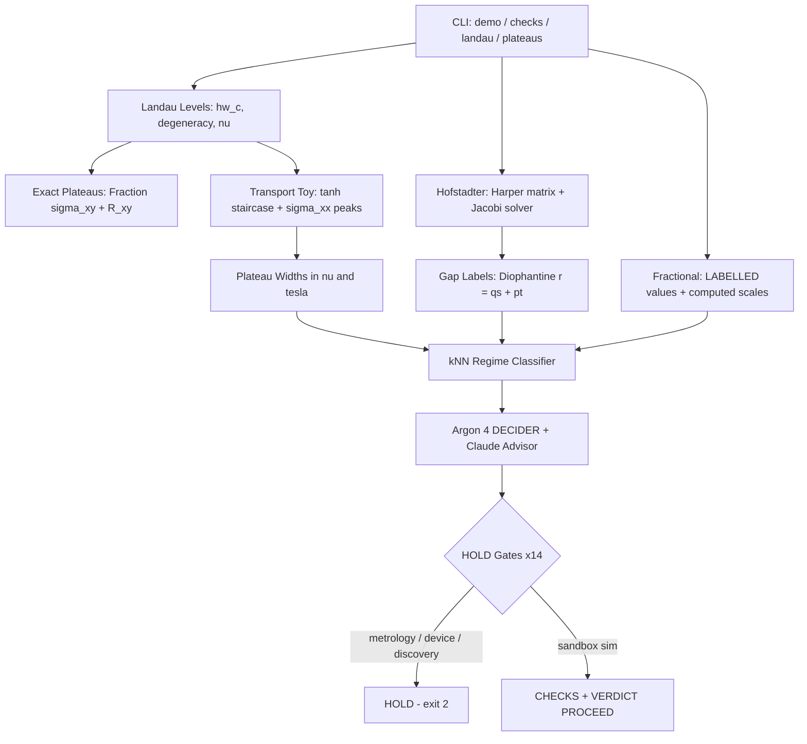
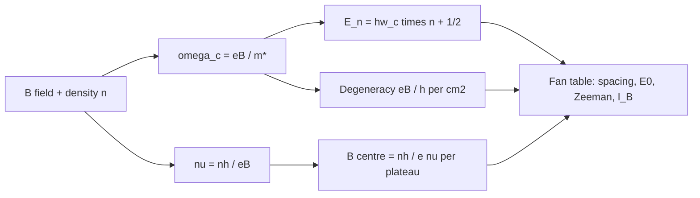
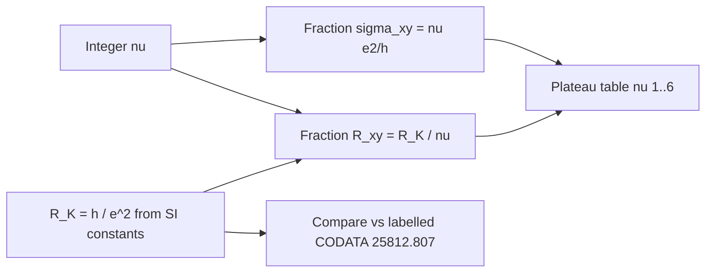
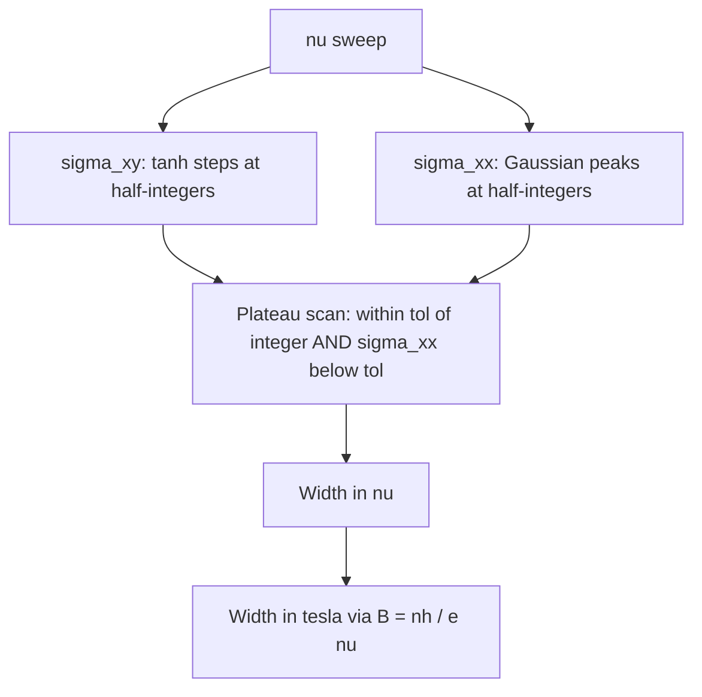
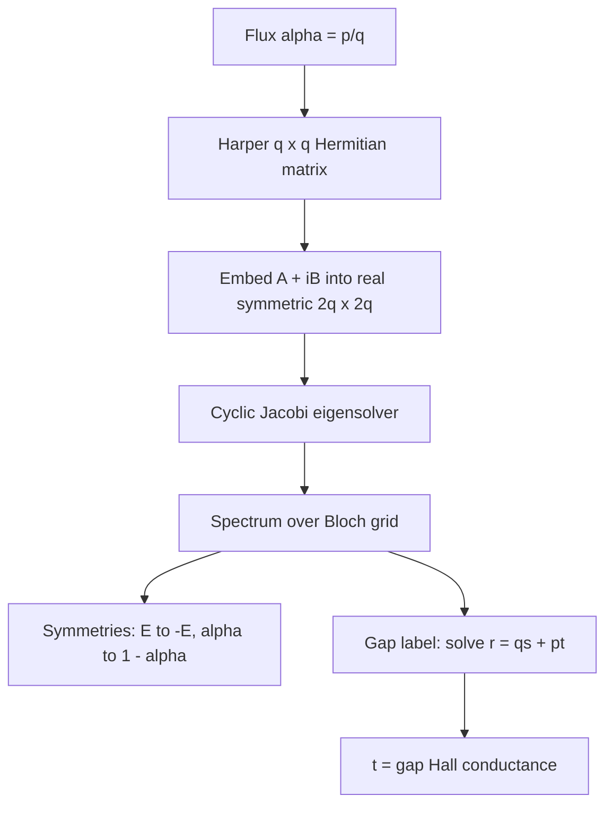
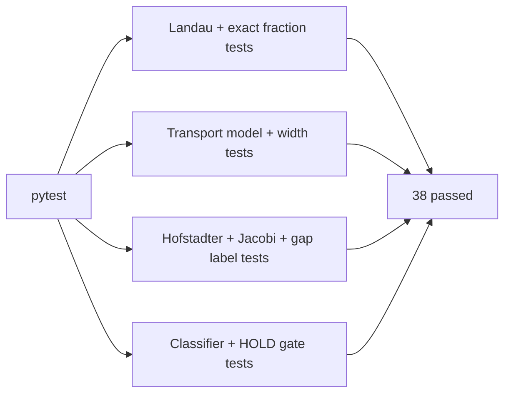
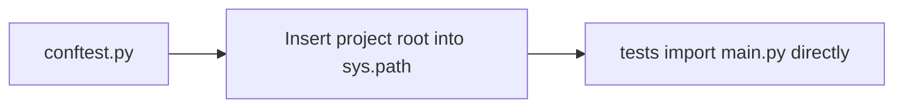
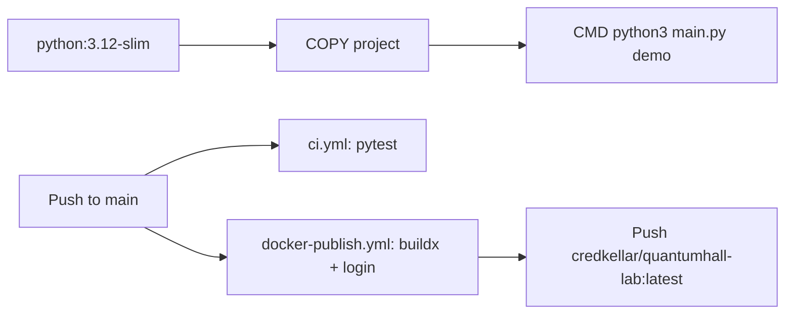

# QuantumHall-Lab 🌀⚛️

**Quantum Hall Effect Lab** — by Darion Kellar

QuantumHall-Lab is an **educational quantum Hall effect lab** in ONE pure-Python file. It builds the integer quantum Hall effect from the arithmetic up: **Landau levels** of a 2D electron gas (E_n = ħω_c(n + ½), degeneracy eB/h per unit area), the **filling factor** ν = nh/(eB), and Hall conductance that is **exactly** ν·e²/h on the plateaus — kept in exact fraction arithmetic so the quantization is never blurred by floating point. The von Klitzing constant R_K = h/e² is **computed from SI constants** (25,812.807 Ω) and checked against its labelled CODATA value.

Around that exact core sit three honest models, each labelled as what it is: a **localization toy model** for the plateau curves (σ_xy as a tanh staircase, σ_xx as Gaussian peaks at half-integer ν, plateau widths computed from the model), the **Hofstadter butterfly** — real spectra of the Harper equation at flux p/q, computed with a from-scratch Jacobi eigensolver, with gap labels solved from the Diophantine equation r = qs + pt — and a **fractional QHE section that is labelled textbook values only**: the Laughlin ν = 1/3 state, its e/3 quasiparticle charge, and a gap *estimate range*, next to the two scales this lab actually computes (magnetic length, Coulomb energy). **No exact diagonalization of a fractional state is run, and none is claimed.**

Honest scope, stated up front: nothing here is measured device data — no sample was cooled, no magnet was energised, no resistance was certified. Every metrology, device, discovery, and facility claim sits behind a permanent HOLD gate (14 total). 🔒

[](https://github.com/kimanicollier44-cmyk/QuantumHall-Lab/actions/workflows/ci.yml)
[](https://github.com/kimanicollier44-cmyk/QuantumHall-Lab/actions/workflows/docker-publish.yml)

> ℹ️ These are the **live** workflow badges for this repo. They activate as soon as the `ci.yml` and `docker-publish.yml` files from the paste pack are pasted into `.github/workflows/` — until then they have nothing to report yet.

## 🧰 Tech Stack Badges & Full Architecture Tech Stack

### 💻 Core Programming Languages & Core Systems


- 🐍 Python 3.12, pure standard library (`math`, `fractions`, `hashlib`, `json`, `sys`) — zero dependencies, zero network, deterministic (double-run byte-identical)
- 🧲 Landau core: ω_c = eB/m*, E_n = ħω_c(n + ½), degeneracy eB/h, ν = nh/(eB), l_B = √(ħ/eB) — every formula asserted against its analytic behaviour in CHECKS
- 🔢 Exact plateau arithmetic with `fractions.Fraction`: σ_xy = ν exactly (in e²/h), R_xy = R_K/ν exactly — quantization with no float blur
- 🦋 From-scratch cyclic Jacobi eigensolver + a Hermitian→real-symmetric embedding for the Harper equation (Hofstadter butterfly, q ≤ 7, 1,440 sampled eigenvalues)
- 🧠 TinyML kNN regime classifier (from scratch, stdlib): plateau / transition / insulating from (ν distance to integer, σ_xx, thermal ratio), labels generated by the lab's own localization model
- 🪑 Council seats: Gemini Argon 4 Extended Thinking DECIDER (names-only, tighten-only) + Muse advisor (never overrides HOLD) + Google Flow plan-only (rendered = False, live = 0)

### ⛓️ Web3 & Infrastructure

- 🚫 **Not applicable — honestly.** No blockchain, no Web3, no tokens: the "infrastructure" in this lab is a labelled analytic model of a 2D electron gas in a magnetic field inside one offline file. No fake badges here.

### ⚙️ Platform Support & Hardware Architecture


- 🖥️ Pure Python — runs anywhere Python 3.12+ runs (Linux, macOS, Windows), plus the `python:3.12-slim` Docker image
- 🔒 No hardware is controlled, ever: real magnets, cryostats, samples, and resistance standards are permanent HOLD gates (see the gate table below)

### ⚡ Low-Level Infrastructure & Performance

- 🚫 **No low-level code — honestly.** No C, no C++, no GPU, no compiled extensions: this is one interpreted Python file on purpose, so every number can be read, checked, and diffed. Performance here means honest algorithms — a cyclic Jacobi eigensolver, an exact-fraction plateau book, and closed-form Landau arithmetic — all deterministic and byte-identical between runs.

### 🛠️ DevOps & Build Tools


- 🐳 Docker (`python:3.12-slim`), GitHub Actions CI + Docker Publish (delivered in the paste pack)
- 🎯 Target image: `credkellar/quantumhall-lab:latest`
- 🧪 Tests: `pytest` (38 tests) + the built-in CHECKS suite (56 checks) in `main.py`

### ☁️ Cloud Providers

- 🚫 **None — honestly.** No cloud provider is used or needed: the lab runs fully offline on your own machine or in a local Docker container. Docker Hub appears only as the registry the publish workflow pushes the image to.

## What this does?

1. 🧲 **Landau levels of a 2DEG** — for a labelled GaAs-style electron gas (m* = 0.067 m_e, g* = −0.44), the cyclotron spacing ħω_c = **17.279 meV at 10 T** (200 K in temperature units), the level ladder E_n = ħω_c(n + ½), the Zeeman splitting beside it (0.255 meV — 68× smaller, which is why spin splitting is a fine structure here), and the degeneracy eB/h = **2.418 × 10¹¹ states/cm² per level per spin at 10 T**.
2. 🎯 **Filling factor and the fan table** — ν = nh/(eB) for the demo density n = 3.0 × 10¹¹ cm⁻² across B = 2…12 T: ν falls from 6.204 to 1.034 while the magnetic length shrinks from 18.14 nm to 7.41 nm. The field for any target filling is inverted exactly (B = nh/(eν)) and round-trip asserted in CHECKS.
3. 🔢 **Exact plateau arithmetic** — on plateau ν, σ_xy = ν·e²/h **exactly** and R_xy = R_K/ν **exactly**, carried as `Fraction` objects end to end: R_xy = 1, 1/2, 1/3, 1/4, 1/5, 1/6 R_K for ν = 1…6, i.e. 25,812.807 Ω down to 4,302.135 Ω, with plateau-centre fields from 12.407 T (ν = 1) to 2.068 T (ν = 6) at the demo density.
4. 🏔️ **Plateau curves from a labelled localization model** — extended states live at Landau centres, so in filling space σ_xy climbs a tanh staircase at half-integer ν while σ_xx fires Gaussian peaks (height 0.5 e²/h) exactly at the transitions and vanishes on the plateaus. Plateau widths are **computed from the model**: every plateau ν = 1…4 is **0.723 wide in ν** (e.g. the ν = 2 plateau spans 2.318 T at the demo density). Model outputs, stated as model outputs.
5. 🦋 **Hofstadter butterfly** — the Harper equation at flux α = p/q is a q × q Hermitian matrix; this lab embeds it in a real symmetric 2q × 2q matrix and diagonalizes it with a from-scratch cyclic Jacobi solver. Over all 17 coprime rationals with q ≤ 7 on a 4 × 4 Bloch grid: **1,440 eigenvalues**, the α = 1/2 band edge at exactly 2√2, spectra symmetric under E → −E and α → 1 − α, all asserted.
6. 🏷️ **Gap labels from the Diophantine equation** — each butterfly gap is labelled by integers (s, t) solving r = qs + pt with |t| ≤ q/2; t is the gap's Hall conductance in e²/h. Computed labels: α = 1/3 gaps → (0, +1) and (1, −1); α = 1/2 → (0, +1); α = 1/4 → (0, +1) and (1, −1). This is the Wannier/TKNN bookkeeping that ties the butterfly back to the Hall conductance.
7. ⅓ **Fractional QHE — labelled values, computed scales** — the Laughlin ν = 1/3 state needs **37.221 T** at the demo density. Labelled textbook values: quasiparticle charge **e/3**, torus degeneracy 3, gap ≈ 0.05–0.1 of the Coulomb scale. Computed by this lab: l_B = 8.113 nm at 10 T and the Coulomb scale e²/(4πεl_B) = **13.759 meV**, putting the labelled gap estimate at 0.688–1.376 meV. A pair-counting sketch (6 electrons, 15 pairs, Laughlin minimum pair angular momentum m = 3) is included and labelled a sketch — **no fractional-state diagonalization is run or claimed**.
8. 🌡️ **Thermal scale** — the classifier's third feature is the ratio k_BT/(ħω_c): at B = 8 T the level spacing is 160 K, so a 0.3 K fridge sits at ratio 0.002 (deep plateau physics) while B = 2 T and T = 40 K gives ratio ≈ 1.0 — thermally smeared, and the model says so.
9. 🏷️ **Regime classifier + seats + checks** — a from-scratch kNN labels (ν, B, T) points plateau / transition / insulating with labels generated by the lab's own localization policy (ν = 3.00 → plateau, ν = 3.50 → transition, ν = 2.65 → insulating, hot low-field → transition), with Argon 4 DECIDER (sha256 trace), Muse advisor, Google Flow plan-only, and a built-in CHECKS suite (56 checks).

## 🗺️ How it works — diagram per script

### `main.py` — the whole lab



### `main.py` § Landau fan — from field to filling



### `main.py` § exact plateaus — fractions, not floats



### `main.py` § transport toy — the labelled localization model



### `main.py` § Hofstadter — Harper spectra + gap labels



### `tests/test_main.py` — verification



### `conftest.py` — test path setup



### `Dockerfile` + CI flow — container & publish



## Why is this cool?

1. 🔢 The quantization is **exact, not approximate**: σ_xy on a plateau is the integer ν carried as a `Fraction` — the code literally cannot print 1.9999997 e²/h, because no float ever touches the plateau book.
2. 🏆 R_K is **derived, not quoted**: h/e² from the SI defining constants lands at 25,812.807 Ω, within 1.8 × 10⁻⁸ (relative) of the labelled CODATA value — the 2019 SI redefinition, felt in one division.
3. 🧲 The Landau fan makes the field do visible work: one table shows the spacing growing to 17.279 meV, the degeneracy to 2.418 × 10¹¹ /cm², and ν draining from 6.204 to 1.034 as B climbs 2 → 12 T.
4. 🏔️ Plateau widths are **computed from a stated model**, not drawn: the localization toy gives every plateau the same 0.723 width in ν, and the tesla widths (10.319 T at ν = 1 down to 0.565 T at ν = 4) fall out of B = nh/(eν) — a prediction of the model you can argue with, because the model is printed.
5. 🦋 The Hofstadter butterfly is **really diagonalized**: 1,440 eigenvalues from a hand-built Jacobi solver, with the α = 1/2 band edge landing on 2√2 and both butterfly symmetries (E → −E, α → 1 − α) asserted to 1e-6.
6. 🏷️ Gap labels connect two worlds: solving r = qs + pt turns a butterfly gap into a Hall conductance — the same integers that label the fractal are the plateau numbers from section 3.
7. ⅓ The fractional section is a **lesson in scientific honesty**: e/3 charge and the gap range are labelled textbook values, the Coulomb scale (13.759 meV) is computed, and the lab states in code, README, and a HOLD gate that it did **not** diagonalize the Laughlin state.
8. 🌡️ Temperature is a ratio, not an afterthought: k_BT/(ħω_c) explains in one number why plateau physics lives in dilution fridges — and why the classifier calls B = 2 T, T = 40 K a smeared transition.
9. 🎯 The kNN classifier can only echo the model that labelled it — and says so: its training grid is swept from the lab's own transport curves, so "plateau / transition / insulating" is the localization policy looking back at itself.
10. 🔁 Deterministic end to end: run it twice, get byte-identical output — a quantum Hall lab you can diff.

## What problems this solves?

1. ❌ **Problem:** QHE explainers say "conductance is quantized" without showing what "exactly" means. ✅ **Solution:** The plateau book is exact fraction arithmetic — σ_xy = ν and R_xy = R_K/ν as `Fraction`s, asserted in CHECKS.
2. ❌ **Problem:** R_K = 25,812.807 Ω is usually memorized as a magic constant. ✅ **Solution:** It is computed from h and e and compared with the labelled CODATA value, relative difference printed (1.8 × 10⁻⁸).
3. ❌ **Problem:** Landau levels are taught as a formula with no feel for scale. ✅ **Solution:** The fan table prices the spacing in meV *and* kelvin, the degeneracy per cm², and l_B in nm, across a real field range.
4. ❌ **Problem:** Plateau widths appear in textbooks as experimental facts with no mechanism attached. ✅ **Solution:** A labelled localization model generates the curves, and the widths are computed from it — mechanism first, numbers second, model status never hidden.
5. ❌ **Problem:** σ_xx is often drawn as an afterthought spike train. ✅ **Solution:** Here it is a first-class output: peaks of 0.5 e²/h exactly at half-integer ν, ~0 on plateaus, and one of the classifier's three features.
6. ❌ **Problem:** The Hofstadter butterfly is shown as a picture, rarely as a computation. ✅ **Solution:** The Harper matrix is built and diagonalized in the open (embedding + Jacobi), with band counts, band edges, and symmetries all asserted.
7. ❌ **Problem:** Butterfly gap labels (the Diophantine equation) are usually skipped entirely. ✅ **Solution:** `gap_label` solves r = qs + pt for the sampled rationals and prints t as the gap's Hall conductance.
8. ❌ **Problem:** Fractional QHE content online routinely implies simulations that were never run. ✅ **Solution:** This lab separates labelled values from computed scales line by line, includes only a counting sketch, and gates fabricated ED behind `fabricated_exact_diagonalization`.
9. ❌ **Problem:** "Low temperature" in QHE is left vague. ✅ **Solution:** The thermal ratio k_BT/(ħω_c) is computed per point and drives a classifier label — smearing is a number, not a vibe.
10. ❌ **Problem:** Simulation tools quietly imply metrology or device readiness. ✅ **Solution:** 14 named HOLD gates return exit code 2 for every metrology, device-characterisation, discovery, or facility claim, forever.

## How to install this?

1. 📋 Clone or download this project folder.
2. 🐍 Make sure Python 3.12+ is installed: `python3 --version`
3. ▶️ Run the full demo + checks (no arguments needed):

```bash
python3 main.py
```

4. 🧪 Run the test suite:

```bash
pip install pytest
python3 -m pytest -q
```

5. 🎛️ Try the other commands:

```bash
python3 main.py checks      # 56 built-in checks
python3 main.py landau      # Landau fan table (JSON)
python3 main.py plateaus    # exact plateau book (JSON)
python3 main.py transport   # plateau widths + sigma_xx peaks (JSON)
python3 main.py hofstadter  # butterfly counts + gap labels (JSON)
python3 main.py fractional  # LABELLED Laughlin book + computed scales
python3 main.py classify    # kNN regime classifier report
python3 main.py brains      # Argon 4 + Muse + Flow seats
python3 main.py holds       # list all 14 HOLD gates
python3 main.py hold-demo   # exits 2 - gated actions stay HOLD
```

6. 🐳 Or run it in Docker:

```bash
docker build -t credkellar/quantumhall-lab:latest .
docker run --rm credkellar/quantumhall-lab:latest
```

## Requirements

- 🐍 Python 3.12 or newer
- 📦 Dependencies: **none** (standard library only)
- 🌐 Network: **none** — fully offline
- 🧪 For tests only: `pytest`
- 🐳 Optional: Docker

## FULL project structure tree

```text
quantumhall-lab/
├── main.py                  # the whole lab: Landau levels, exact plateaus, transport toy, Hofstadter butterfly, labelled fractional book, classifier, seats, HOLD gates
├── conftest.py              # puts the project root on sys.path for tests
├── tests/
│   └── test_main.py         # 38 pytest tests: Landau, fractions, transport, Hofstadter, classifier, gates, determinism
├── assets/
│   └── cover.png            # README cover image (2736 x 912)
├── Dockerfile               # python:3.12-slim, runs the demo
├── .gitignore               # __pycache__/, .pytest_cache/, *.pyc
└── README.md                # this file
```

> 📦 Delivered separately as paste packs (not in this tree): `.github/workflows/ci.yml` + `docker-publish.yml`, and the Docker Hub pack (100-char description, 350-char About, overview, categories).

## 🔒 HOLD gates — all 14, permanent

| # | Gate | What stays held |
|---|------|-----------------|
| 1 | `metrology_standard_claim` | No metrology use; R_K computed from constants is arithmetic, not a resistance standard |
| 2 | `measured_device_data_claim` | No presenting model output as measured device or sample data |
| 3 | `real_device_characterisation` | No characterising a real device, wafer, or heterostructure from this lab |
| 4 | `resistance_standard_operation` | No operating or certifying a quantum Hall resistance standard |
| 5 | `cryogenic_magnet_operation` | No directing cryogenic, dilution-refrigerator, or magnet operation |
| 6 | `high_field_safety_signoff` | No safety sign-off for high-magnetic-field facilities or procedures |
| 7 | `fractional_state_discovery_claim` | No claiming discovery or observation of fractional quantum Hall states |
| 8 | `fabricated_exact_diagonalization` | No presenting exact-diagonalization results that were not actually run |
| 9 | `semiconductor_design_signoff` | No real semiconductor device or heterostructure design sign-off |
| 10 | `calibration_certificate` | No issuing calibration certificates or traceability documents |
| 11 | `textbook_value_as_measurement` | Labelled textbook/CODATA values must never be presented as this lab's measurements |
| 12 | `quantum_sensor_product_claim` | No product claims for Hall sensors or magnetometers based on this lab |
| 13 | `production_fab_claim` | No fabrication-process claims for real cleanrooms or production lines |
| 14 | `investment_claim` | No investment claims; a teaching model is not a prospectus |

🧑‍⚖️ **Council seats:** Gemini Argon 4 Extended Thinking — DECIDER (names-only, tighten-only, MAP → MODEL → STRESS → DECIDE, sha256 trace, `can_override_hold = False`) · Muse — advisor (`can_override_hold = False`) · Google Flow — plan-only (`rendered = False`, `live = 0`).

✅ **Verification:** pytest **38 passed** (project + clean copy) · built-in CHECKS **56/56** · double-run output **byte-identical** · `hold-demo` exits **2** · `main.py` **895 lines**, pure stdlib, zero network.

## 🧒 5th-grade English section

Imagine a big flat swimming pool full of tiny balls that can roll anywhere. Now turn on a giant magnet above the pool. 🧲

- The balls stop rolling any way they like. They start running in **circles**, and only certain circle sizes are allowed — like lanes on a running track. These lanes are called **Landau levels**. A stronger magnet squeezes more balls into each lane. This lab counts the lanes and the balls with math. 🏃
- If you push the balls from one side of the pool, they don't just go straight — the magnet bends their path, so they pile up along one edge. The push-back you can measure sideways is called the **Hall resistance**, and something amazing happens: as you turn the magnet up, the resistance doesn't slide smoothly — it jumps in **steps**, and every flat step is a perfect fraction like 1, 1/2, 1/3, 1/4 of one special number. This lab shows those steps with exact fractions, no rounding. 🪜
- The flat steps are wide because most balls are stuck in little whirlpools and can't move; only balls in the middle of a lane can travel. When the magnet tunes the water level to the middle of a lane, the sideways resistance jumps to the next step and the forward resistance flashes a spike. The lab draws those spikes too. 🌀
- If the magnet pattern makes a fancy lace of allowed and forbidden energies, it looks like a **butterfly** when you draw it — scientists really call it the Hofstadter butterfly. This lab computes the butterfly itself, with its own math tools, and labels each gap with secret number codes that also tell you the step height. 🦋
- At one very special step — one third — the balls team up into groups that act like they carry **one third** of a ball's charge. Grown-up books say that; this lab repeats it clearly marked as "from the books", because the lab did **not** run that hardest experiment itself. Honest science says what it did and what it only read about. 📚
- This project is a **pretend lab on a computer**. It does not cool a real chip, turn on a real magnet, or measure a real sample. It helps you learn why resistance comes in perfect steps — one of the strangest and most beautiful facts in physics. 💻

---

MIT © 2026 Darion Kellar · QuantumHall-Lab — educational simulation only 🌀
